# Using beamdash

A practical guide to inspecting Erlang and Elixir nodes, with screenshots from a disposable local application. Start with a node overview, find the process involved, then collect a short trace or profile to test your explanation.

Screenshots were captured on 20 October 2026 using OTP 29, Erlang syntax and a 1280 × 720 browser viewport. Hostnames, PIDs, timings and memory values will differ on your machine. Jev and saved connections are disabled in the screenshot demo.

## Contents

- [Start and connect](#start-and-connect)
- [Try the screenshot demo](#try-the-screenshot-demo)
- [Find your way around](#find-your-way-around)
- [Check the node](#check-the-node)
- [Inspect a process](#inspect-a-process)
- [Investigate garbage collection](#investigate-garbage-collection)
- [Find memory growth](#find-memory-growth)
- [Follow applications and supervision](#follow-applications-and-supervision)
- [Trace function calls](#trace-function-calls)
- [Follow messages](#follow-messages)
- [Profile functions](#profile-functions)
- [Read crash reports](#read-crash-reports)
- [Settings and Jev](#settings-and-jev)
- [Add plugins](#add-plugins)
- [Choose an investigation](#choose-an-investigation)
- [Troubleshooting](#troubleshooting)

## Start and connect

Install the project dependencies and start the web application from the repository root. beamdash requires Elixir 1.15+ and OTP 25+; profiling a target requires OTP 27+.

```sh
mix setup
mix phx.server
```

Open [localhost:4000](http://localhost:4000). In a second terminal, start a named node to inspect:

```sh
erl -sname foo -setcookie demo_cookie
```

1. Enter `foo` or its full `foo@hostname` name in **Node** in the connection bar.
2. Enter `demo_cookie` in **Cookie**, then click **Connect**. Use your target's actual cookie when connecting to your application.
3. Check that the node name and **Disconnect** replace the form, and that OTP, process count and memory appear below it.

The connection bar is shared by every tab. beamdash starts distribution on first connect, matching short or long names to the target, and connects as a hidden node. Switching between a short-named and a long-named target (including across Direct and kubectl) restarts distribution with the matching mode automatically; this only fails if beamdash itself was started as a named node (`-sname`/`-name`), since Erlang cannot change that from under a running one. Disconnect ends the shared connection for all browser tabs.

With **Settings → Reconnect automatically** on, a connection lost because the node went down (or its kubectl tunnel failed) is made again the same way: after 1, 2, 5 and 10 seconds, then every 15 seconds until it works. Meanwhile the bar shows **Reconnecting to …** with the next try's time and the last error; **Stop** ends the tries, as do Disconnect and connecting elsewhere.

To connect to a node running in a Kubernetes pod, switch the bar to **kubectl** instead of **Direct**. Pick the **Cluster** from the dropdown (one entry per `.yaml`/`.yml` kubeconfig file under `~/.kube`, or the directory set in **Settings → Kubeconfig directory**; beamdash passes it to `kubectl` directly, so there is no need to run a context-switching shell command first), enter the namespace and click **List pods**, pick the **Pod** from the dropdown, then the **Container** and **Binary** if more than one is available, then **Connect**. beamdash reads the node name and cookie off the pod itself (via `kubectl exec ... rpc`) and opens `kubectl port-forward` tunnels for epmd and distribution, so there is no node name or cookie to type.

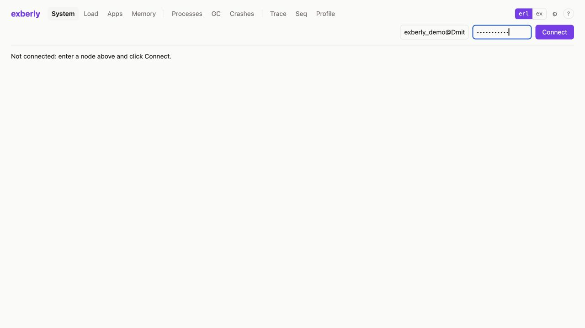

*The demo node is prefilled here; a fresh installation may have empty fields.*

## Try the screenshot demo

The included [demo launcher](demo.exs) starts beamdash and a separate local Erlang node, connects them, and sends an order every 250 ms. It provides two gen_servers, a supervisor, an ETS table and a retained 1 MiB binary. It makes no Jev requests and saves no connection credentials.

After `mix setup`, run this **instead of** `mix phx.server`:

```sh
mix run --no-start docs/demo.exs
```

Open the URL printed in the terminal. To use another port when 4000 is occupied:

```sh
PORT=4101 mix run --no-start docs/demo.exs
```

Filter processes by `demo_`. `demo_shop` handles orders and repeatedly allocates lists; `demo_inventory` answers price requests, owns `demo_cache`, and retains the binary. These are examples of normal activity, not an intentional leak. The demo prints its full node name and uses the local example cookie `demo_cookie` if you disconnect and reconnect manually.

To produce a crash report, run the following in another terminal while the demo is running (macOS):

```sh
touch /private/tmp/beamdash-demo-crash
```

The demo consumes the marker, crashes `demo_shop`, and its supervisor restarts the worker with a new PID. Stop the launcher with **Ctrl+C twice**. The demo uses the node names `beamdash_docs` and `beamdash_demo`; run one copy at a time.

## Find your way around

| Group | Tab | Use it for | Shortcut |
| --- | --- | --- | --- |
| Node | System | Versions, capacity, limits and totals | `g s` |
| Node | Nodes | The node's cluster; click a node to connect to it | `g n` |
| Node | Load | Scheduler, memory and IO trends | `g l` |
| Node | Apps | Application process trees | `g a` |
| Node | Memory | Process, binary and ETS investigations | `g m` |
| Processes | Processes | Find and inspect a process | `g p` |
| Processes | GC | Heap trends and recorded GC pauses | `g c` |
| Processes | Crashes | Abnormal exits and stack traces | `g x` |
| Tracing | Trace | Function arguments, results and duration | `g t` |
| Tracing | Seq | Messages caused by traced calls | `g q` |
| Tracing | Profile | Function time, call counts or allocations | `g f` |
| Settings | ⚙ | Saved connection, auto-reconnect, kubeconfig directory and optional Jev switch | `g ,` |

Press `g`, then the second key; shortcuts do not fire while typing in a field. **?** lists them. Tabs that do not fit are under **More ▾**. Use **erl / ex** to change the displayed syntax for terms, functions and PIDs.

## Check the node

Open **System** to establish the runtime version, scheduler capacity, memory totals and resource limits. Check the run queue and the proportion of atoms, processes, ports and ETS tables used. The screen refreshes every ten seconds; **Refresh** reads it immediately.

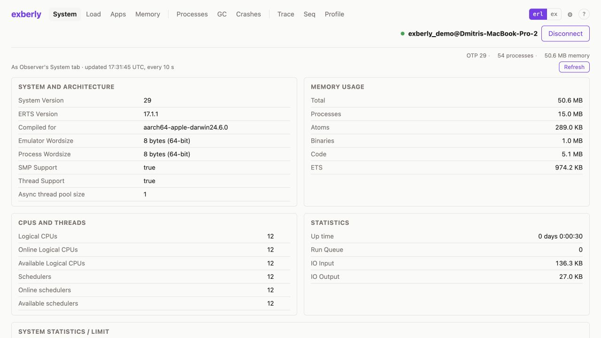

Open **Nodes** to see which nodes the attached one is connected to (`nodes()`, refreshed every five seconds; **Show hidden** adds hidden connections such as remote shells). Click another node to move the connection there; beamdash uses the cookie the attached node has for it, so there is nothing to type. This works for direct connections only: the other nodes of a pod's cluster are not reachable through its kubectl tunnel. Plugins can link node names the same way (the riak_core plugin does for owners and members): clicking one switches the connection and returns to the plugin page.

Open **Load** and leave it visible while reproducing the symptom. It samples twice per second and shows the last 60 seconds. Hover or focus a scheduler legend item to highlight its line; dotted lines represent dirty CPU schedulers. In a lightly loaded demo, low scheduler percentages are expected.

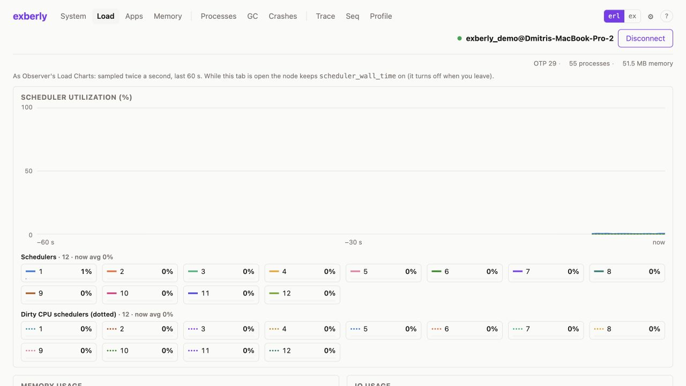

*The sampler enables scheduler wall-time accounting while this tab is open and stops when you leave or disconnect.*

## Inspect a process

1. Open **Processes**, filter by name, PID or function, and click a column header to sort. Use **reductions per second** to find work happening now; cumulative reductions reflect the process's lifetime.
2. Click a process row to open its detail panel. The PID identifies this particular instance; **Status** is the current runtime state.
3. Compare reductions, memory and mailbox trends while reproducing the workload. A process can be `waiting` between bursts of substantial work.
4. Scroll the panel to inspect heap/binary details, mailbox, current stack, links and monitors. Click a related local process to inspect it.

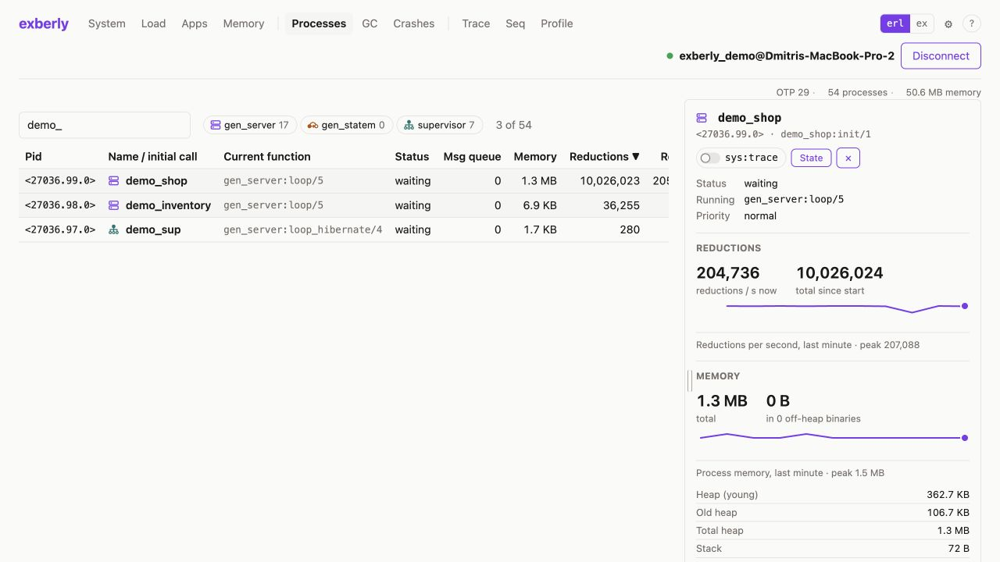

For a gen_server or gen_statem, click **State** to read its current state in the bottom dock. **Refresh** reads it again. Erlang records show field names when debug information is available. A busy process may time out rather than answer the state request.

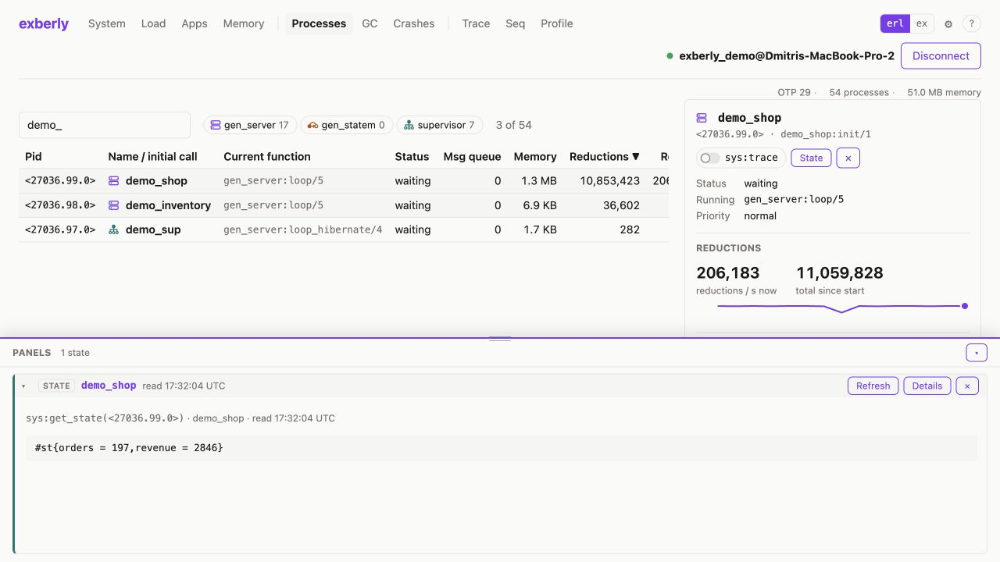

The **sys:trace** switch records OTP calls, casts, replies and state changes in a dock panel for that process. Click an event for details, use **Stop** when finished, and **Clear** to clear the panel. Events also print on the target console. Drag the dock's top edge to resize it; click another panel's header to activate it. Supervisors offer a **Supervisor tree** action in the dock.

## Investigate garbage collection

GC operates per process, so begin with the process involved in the symptom. A node-wide collection rate alone does not identify which process is responsible.

1. Open **GC**, or use **GC ↗** from a selected process's details.
2. Filter and select the process. Compare its memory, young/old heap and referenced binaries over representative work.
3. Scroll to **GC trace** in the detail panel. Choose **For**: 1, 5, 10, 20 or 30 seconds, then click **Trace GC**.
4. Keep the page open while the workload runs. Recorded events appear directly below those controls, with minor/full counts, total and longest elapsed GC time, and heap sizes before/after each collection.
5. Click **Stop**, or let the selected duration expire. Tracing also stops after 200 collections, overload or leaving the page.

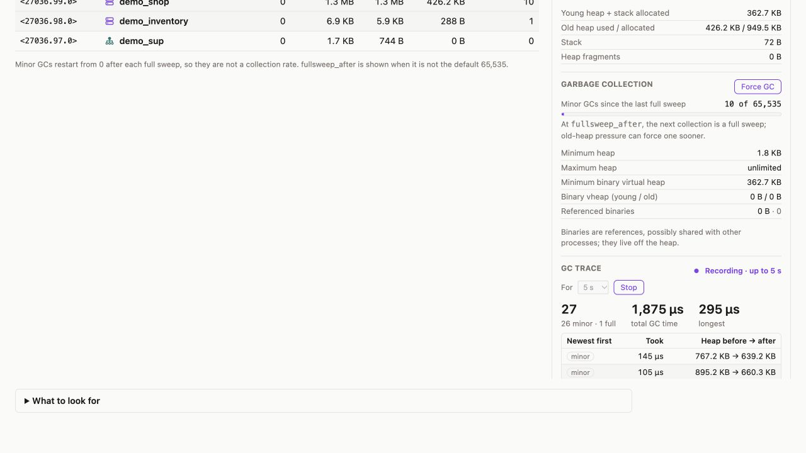

*This screenshot is scrolled down to the GC trace controls in the selected process's detail panel.*

Expand **What to look for** for interpretation hints; it stays open during automatic refresh. Read the counters carefully:

- **Minor GCs** counts collections since the last full sweep. It resets and is not a collection rate.
- **fullsweep_after** is a threshold, not a pause duration; old-heap pressure can cause a full sweep earlier.
- The recorded duration is elapsed target time between GC events, not CPU time. The heap sizes shown exclude off-heap binaries.
- A sawtooth heap that repeatedly returns to a similar baseline can be normal allocation. A rising baseline after collections needs further investigation.

**Force GC** collects the selected process and reports what was freed. It changes the target's behavior and can delay that process: first collect representative evidence, then compare before/after if a forced collection will answer a specific question. Reclaimed memory does not by itself establish a leak.

If no events appear, confirm recording is active and that you are looking below **GC trace**. An idle process may perform no collections during the window. In the demo, `demo_shop` generates collections naturally; `demo_inventory` can remain quiet.

## Find memory growth

Open **Memory** to compare memory by kind and its trend. **Allocated from the OS** and **used** are different quantities: allocator space can remain reserved after objects are freed.

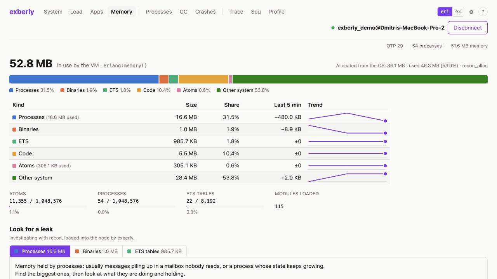

Under **Look for a leak**, choose the category that is growing:

| View | Next step |
| --- | --- |
| Processes | Rank by memory, message queue or reductions; use **Inspect** or **Details** on a candidate. Check state growth and unread messages. |
| Binaries | Find the processes holding the most binary memory. Inspect the holder, even when its own heap is small. |
| ETS tables | Find growing tables, their owners and table properties; investigate why entries accumulate. |

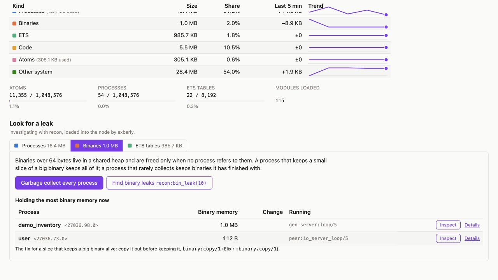

A small sub-binary may keep a much larger shared binary alive. Binary references may be shared by processes, so adding holder sizes can count the same binary more than once. In application code, copying a retained fragment with `binary:copy/1` or `:binary.copy/1` can release the larger backing binary when no other references remain.

**Garbage collect every process** and **Find binary leaks** actively collect processes; the latter uses `recon:bin_leak/1`. They can add work and latency to the node. Start with the holder list and a targeted process investigation before using these broader actions. A live binary retained in application state, as in the demo, remains after GC.

## Follow applications and supervision

Open **Apps**, choose an application on the left, then select a process in its tree. **Process info** opens that process on the Processes tab. The tree refreshes every five seconds and follows application process links as Observer does.

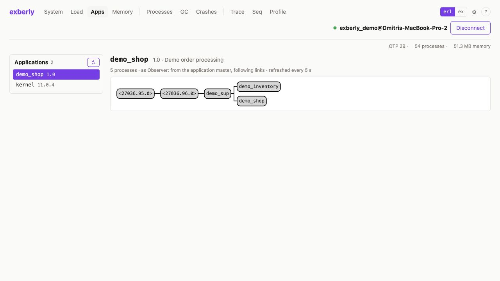

In the demo, `demo_sup` supervises `demo_inventory` and `demo_shop`. After the deliberate crash, the worker name remains but its PID changes. Re-select the replacement process before taking measurements.

## Trace function calls

1. Open **Trace**, filter the loaded modules, and choose `demo_shop` in the demo.
2. Pick `checkout/1`. Search by function name or `name/arity` when a module has many functions; multiple functions can be selected.
3. Leave the default **30 calls** limit for a short capture and click **Trace**. The label includes the selection count for multiple functions.
4. Exercise the application. The demo already calls checkout every 250 ms.
5. Click a call row to expand arguments, result and stack details. Use **Stop trace**, **×**, or **Stop all** to finish early. **Clear log** clears displayed entries.

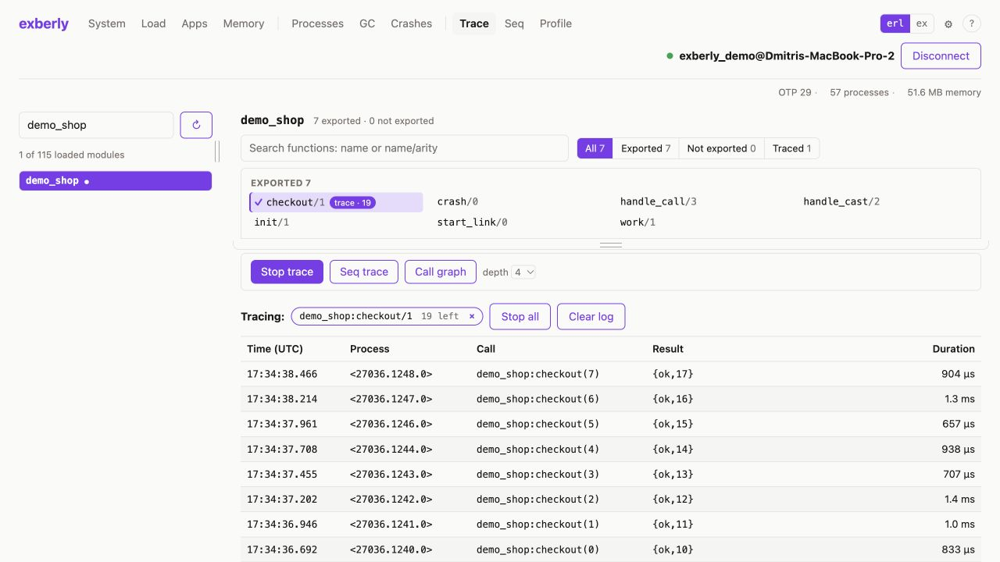

Tracing captures future calls; opening a function does not replay previous activity. An empty call limit continues until stopped. **Trace all … functions** captures the whole module and can generate substantially more data. Function tracing uses `dbg` and conflicts with another tool using `dbg` on the same target; the target needs `runtime_tools`.

For one selected function, **Call graph** explores static calls to a chosen depth. It needs target `tools`/xref and module debug information. A call graph describes possible code relationships; a trace records calls that actually happened.

## Follow messages

1. On **Trace**, select the function that begins the workflow and click **Seq trace**.
2. Open **Seq** while exercising that workflow. Messages caused by those calls appear as arrows between processes and as rows beneath the diagram.
3. Enable **show receives** when receive events are useful. Compare request/reply paths and identify unexpected fan-out or repeated exchanges.
4. Use **×** beside a function or **Stop all** to end sequence tracing. **Clear** removes the captured messages.

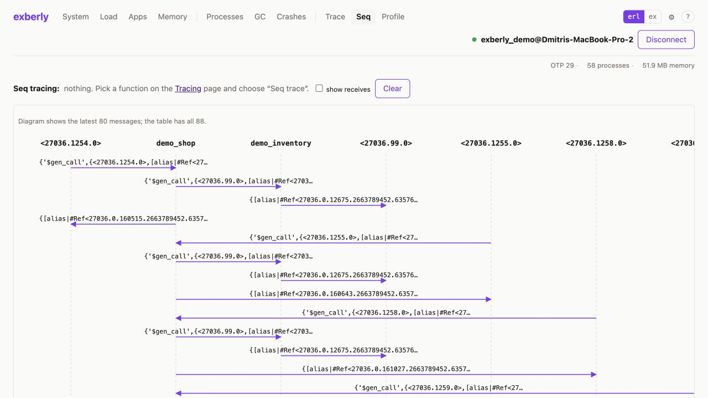

The demo shows a caller → `demo_shop` → `demo_inventory` request path and replies returning. Each remote checkout invocation has a fresh caller PID. The diagram caps the visible message count; the table can contain more, as the page indicates.

## Profile functions

Profiling requires **OTP 27+ on the target**.

1. Open **Profile** and choose **Call time**, **Call count**, or **Memory** (heap allocated by functions).
2. Pick functions in the module browser, or enter a pattern such as `demo_shop:work/1` under **Or type patterns**.
3. Choose the process scope and a short duration, then click **Start profiling**. Start with the default ten seconds; generate representative traffic during the run.
4. Use **Refresh results** while it runs, **Stop now** to finish early, or wait for the final results.
5. Sort the results, filter functions, and use **Show** to inspect one process or the total.

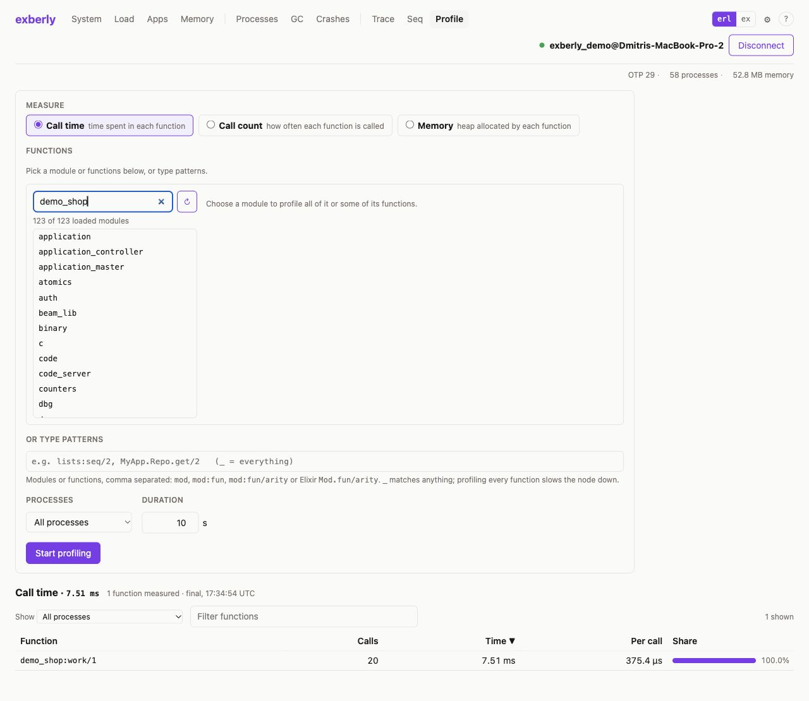

**Call time** locates expensive functions, **Call count** finds frequent calls, and **Memory** finds allocation activity. Allocated bytes are not retained bytes and do not prove a leak. Keep function and process scope narrow: profiling everything with `_` adds more overhead. Percentages are shares of the measured result, not the node's total CPU use.

## Read crash reports

Open **Crashes** after connecting. Reports from abnormal exits of processes started with `proc_lib`—including gen_servers, supervisor children and Tasks—arrive as they happen.

Click a report to expand the reason, stack and process information. Start with the first application frame in the stack, then check ancestors, links, queued messages and the initial call.

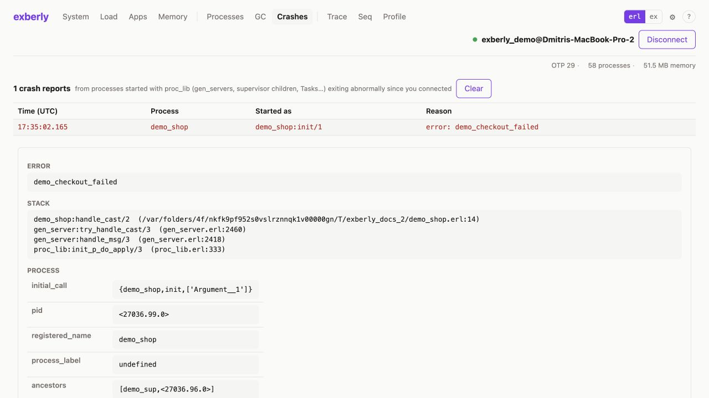

The demo's deliberate error is `demo_checkout_failed` in `demo_shop:handle_cast/2`. Its supervisor restarts it. The report describes the old instance, not the replacement PID. This view records reports since connection; it does not import a pasted historical crash log. **Clear** clears the displayed reports.

## Settings and Jev

Open **⚙ Settings**. A normal successful connection saves the last node and cookie in your user configuration directory; **Forget** clears them. **Reconnect automatically** (off by default, saved across restarts) makes a lost connection again, as described in [Start and connect](#start-and-connect). **Kubeconfig directory** (default `~/.kube`) sets where the kubectl connection looks for cluster kubeconfig files; **Save** applies it to the connection bar in every open tab until restart, and the line below the field says how many clusters it found. The cookie is stored as plain JSON in a file readable only by your user. The demo disables remembering, which is why its Settings page shows this message:

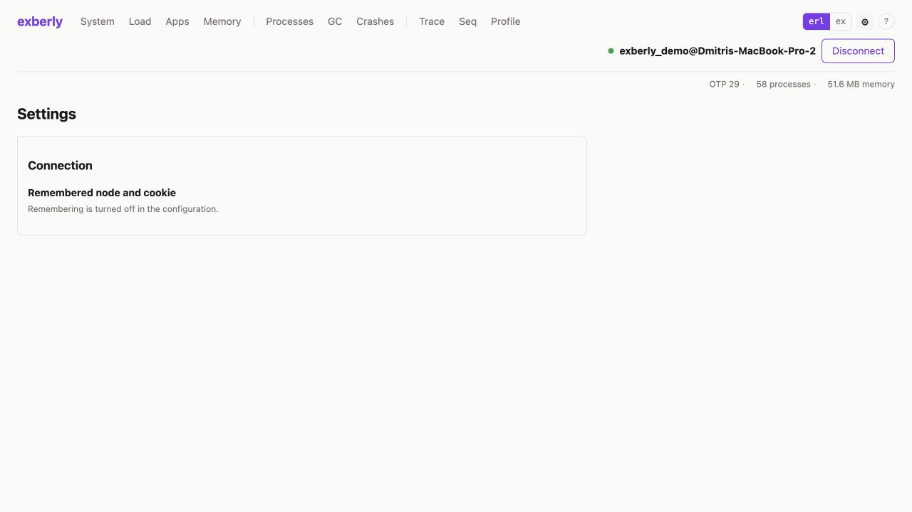

Jev is optional. To enable it, set your key in the shell that starts beamdash, then restart the application. Keep the real value outside the repository:

```sh
export TYPESAFE_API_KEY='your-key-here'
mix phx.server
```

With a configured key, **Settings → Enable Jev analysis** toggles Jev for all open tabs until restart. With no key, `JEV_ENABLED=false`, or `enabled: false` in configuration, the Jev UI—including its Settings switch—is hidden. The screenshot demo explicitly disables it.

For process or GC analysis, keep a process selected through at least 15 seconds of representative work. When **Jev: next step** is ready, click **Analyze**, review the suggestion and **What is sent to TypeSafe**, then verify the suggestion with a trace, state inspection or profile. The GC analysis also considers recorded GC statistics. Jev suggests an investigation; it does not change the target.

Other optional entry points are **Ask beamdash**, **Jev: triage busiest processes**, Memory's health check and Seq's message-flow analysis. Process/GC requests use derived anonymous metrics, not process names, PIDs, messages, state or stacks. **Ask** sends the question you type. The API key remains on the beamdash host. Requests can incur service charges; TypeSafe's documented retention is unspecified. The default model is `jev-1.13.0`; `TYPESAFE_MODEL` overrides it.

## Add plugins

Plugins add pages for one application, such as riak_core, under a **Plugins** menu. The menu shows a plugin's pages only while the application it supports runs on the attached node.

Open **⚙ Settings → Plugins**, type the plugin as a Mix dependency and click **Add**:

```elixir
{:riak_core_plugin, "~> 0.1"}
{:riak_core_plugin, git: "https://github.com/dskliarov/beamdash-riak-core-plugin", tag: "0.0.1"}
{:riak_core_plugin, path: "~/src/beamdash-riak-core-plugin"}
```

A Hex requirement resolves to the highest matching release that `mix hex.info` lists; Hex lists only recent releases, so give an exact version (`"== 0.1.0"`) for an older one. Hex plugins need Hex (`mix local.hex`). Git takes `tag:`, `branch:` or `ref:`. beamdash fetches only the plugin's own source, checks and compiles it, and loads it without a restart. Installed plugins are kept in the `plugins` folder of your user configuration directory; the card shows the path. A path plugin is compiled from its own folder, which must not be inside that `plugins` folder; after changing its code, click **Rebuild**. **Remove** unloads a plugin and deletes its installed files, never a path plugin's folder.

Each plugin shows its status: **active** when a supported application runs at a matching version, **waiting** when none runs, and **incompatible** when one runs at a version the plugin doesn't support. A plugin that fails to build shows the error and never stops beamdash.

A plugin runs inside beamdash with full access to the nodes you connect to, and compiling it runs its code inside beamdash. Add only plugins you trust.

To write a plugin, start from the riak_core plugin ([beamdash-riak-core-plugin](https://github.com/dskliarov/beamdash-riak-core-plugin)) and the `Beamdash.Plugin` docs. The rules the install checks:

- The entry module does `use Beamdash.Plugin`, with a name and pages; each page does `use Beamdash.Plugin.Page`. `main:` names the main page (the first page by default): the **Apps** tab shows it as a tab of each application the plugin supports.
- The supported applications are `runtime: false` deps in `mix.exs`. beamdash reads `mix.exs` as data and never runs it.
- No other runtime deps: a plugin can use only what beamdash ships (Elixir, Phoenix, LiveView, Jason…).
- Code on the attached node is called only through `Beamdash.Plugin.rpc/5`.
- Every module sits under one top-level prefix, which no module beamdash, OTP or another plugin has loaded may already use.
- Protocol implementations have no effect: beamdash's protocols are consolidated.

## Choose an investigation

| Symptom | Start here | Evidence to collect |
| --- | --- | --- |
| CPU rises | Load → Processes by reductions/s → Profile | Busy schedulers, current worker rate, expensive or frequent functions |
| Process memory grows | Memory → Processes → selected process | Memory baseline, state growth, mailbox trend and GC behavior |
| VM memory grows but process heaps look small | Memory → Binaries / ETS tables | Binary holders, shared backing binaries, growing tables and owners |
| GC appears expensive | GC → select process → timed Trace GC | Minor/full counts, elapsed pauses, heap changes under representative load |
| Requests slow or queue up | Processes → mailbox/stack → Seq | Queue growth, waiting calls, responder and reply path |
| A worker disappears/restarts | Crashes → Apps | Exit reason, application stack, supervisor and replacement PID |

## Troubleshooting

| Problem | What to check |
| --- | --- |
| Cannot connect | Target is running with `-sname` or `-name`; hostname resolves; cookie matches; epmd and distribution ports are reachable. Read the connection error. |
| "needs the other short/long name mode" error | beamdash itself was started as a named node (`-sname`/`-name`), so it can't restart distribution in the mode this target needs. Restart beamdash without `-sname`/`-name` (or with the matching mode). |
| Empty trace | Start tracing before the work occurs, verify module/function/arity and remaining call limit, and check that another `dbg` session has not taken over. |
| Empty GC trace | Select an allocating process, start recording, keep the GC page open and scroll to the events under **GC trace**. Extend the duration for intermittent activity. |
| Charts look empty | Allow fresh samples to arrive. History begins when the view starts collecting; it is not historical telemetry from before connection. |
| State request times out | The process may be too busy or blocked to handle the OTP system request. Inspect its current stack and queue. |
| Profile unavailable | The target needs OTP 27+ and `tprof`; select a compatible target. |
| Jev switch or Analyze is missing | Check the server's `TYPESAFE_API_KEY`, environment/config disable flags and the Settings switch. Restart after changing environment variables. |
| Jev Analyze is disabled | Keep the same process selected long enough to collect the required history, during representative work. |
| A Hex plugin says "Hex is not installed" | Run `mix local.hex` as the user who runs beamdash, then add it again. |
| PID disappears after a crash | Find the replacement by registered name in Processes or Apps; the old PID is no longer the worker. |
| `observer:start()` fails with `wx` / `No driver found` | Observer's desktop GUI needs a working Erlang wx driver. beamdash's browser UI can inspect the node without starting `observer_wx`; repairing the GUI requires a wx-enabled Erlang installation. |

## Refreshing the screenshots

Run the demo and repeat the steps above. Save JPEG screenshots under `docs/screenshots/` using the same names; use synthetic demo data and keep real cookies, keys, messages and state out of the images. Capture a short GC trace on `demo_shop`, trace `checkout/1`, profile `work/1`, and generate the crash only after collecting the earlier screenshots. Scroll or capture the full page when needed so the relevant output is visible.

## Remote console

Open **Console** after connecting to a node. Choose Erlang or Elixir and type at
the numbered prompt. **Enter** submits, and **Shift+Enter** inserts a newline.
Erlang commands require a terminating period. Incomplete Erlang input and Elixir
blocks, strings and expressions continue on the next line at a `...>` prompt;
they are not evaluated until complete. Elixir mode requires Elixir on the target.

For example, evaluate `X = 21.` followed by `X * 2.` in Erlang, or `x = 21`
followed by `x * 2` in Elixir. Bindings and the evaluator process persist within
that page's session. Standard output and the result appear in the transcript;
**Reuse** copies a prior command into the input. The transcript retains the last
50 commands, with up to 64 KB of output per command. **↑/↓** recalls the last 100
commands per language at the first/last input line; moving forward past the newest
command restores the unsent draft. History stays in this page's memory and is
cleared when the target changes or the page closes.

**Clear transcript** (**Ctrl+L**) keeps bindings and command history.
**Ctrl+C** clears incomplete input, or interrupts a running command and resets
its evaluator. Selecting text keeps Ctrl+C available for copying.
**Reset session** creates a fresh evaluator
on the next command and clears bindings. Changing language also resets the
session. Leaving the page or losing the connection closes the remote session.

Commands run on the target with its permissions and can change live state. An
evaluation times out after five seconds, killing the evaluator and clearing its
bindings; this does not undo side effects or terminate processes the command
spawned. Interactive input prompts and IEx shell helpers are unavailable. Elixir
variable bindings, aliases, imports, and evaluation environment persist across
commands.

The console's **Autocomplete** option suggests loaded modules and exported
functions from the connected node. Type a prefix such as `Enum.ma` in Elixir or
`lists:ma` in Erlang. Use the arrow keys to select, Tab or Enter to insert,
Escape to dismiss, or Ctrl+Space to request suggestions. Suggestions include
function arities and insert the call's opening parenthesis (both parentheses for
zero-argument functions). Completion reads metadata without evaluating code; it
does not resolve variables or aliases created inside expressions.

## Console notebooks

Choose **Console → Notebooks** to create or import Livebook `.livemd` files.
The format follows Livebook's LiveMarkdown conventions: a level-one notebook
title, level-two section headings, Markdown, fenced Elixir/Erlang code cells,
and `<!-- livebook:... -->` metadata. The original Shell mode remains available.
See the upstream [format definition](https://github.com/livebook-dev/livebook/blob/main/lib/livebook/live_markdown.ex)
and [attached-node runtime](https://github.com/livebook-dev/livebook/blob/main/lib/livebook/runtime/attached.ex)
for the Livebook functionality this integration is based on.

Use **Save** to write a `.livemd` file to the folder shown in the notebook
sidebar. `config :beamdash, :notebooks_dir, "/path/to/notebooks"` changes the
folder; by default it is the `notebooks` folder in Beamdash's user data directory.
**Download .livemd** exports a browser download, and **Import** opens a local
`.livemd` file without executing it. Existing files are only overwritten if they
have not changed since opening/saving; otherwise choose a new filename. The
source limit is 2 MiB. Optionally include evaluated text outputs when saving.
Saving uses `python3` for an operating-system file lock shared between local
beamdash processes. The lock is released if the process exits unexpectedly.

Add Markdown, Elixir, Erlang, or section blocks. Code cells have syntax coloring
and completion. **Run cell** uses the current per-language session on the
connected node. **Run all** resets notebook sessions and executes supported cells
in file order, stopping at the first error. Elixir bindings, aliases, imports,
and requires persist between cells. Erlang and Elixir use separate sessions.
Editing marks cached results stale; run all to rebuild state in order. Cell
timeouts are selectable from 5 to 60 seconds, with a 32 KiB execution limit per
cell. Closing the page closes notebook sessions; disconnecting preserves unsaved
source but resets execution state. **Reset runtime** cancels an active evaluation.
Effects on the node and processes spawned by code are not rolled back.

This provides LiveMarkdown file interoperability and connected-node code/Markdown
notebooks. It does not embed the Livebook application or its reactive dependency
graph. Smart cells, Python cells, persisted output blocks, unknown metadata and
signatures are preserved when untouched. Unsupported cells cannot run, and
branching notebooks are not executable here. Kino widgets, attachments, Mermaid,
math rendering, package installation, collaboration, and application deployment
require Livebook. Signatures are not verified and are removed after content or
output changes. No code runs merely by opening/importing a notebook, including
setup cells and automatically reevaluating-cell annotations.

### Modules source editor

The Modules tab uses a locally bundled CodeMirror 6 editor for Elixir and Erlang.
It includes line numbers, folding, bracket matching, undo/redo, and search.
Use Ctrl/Cmd+F to search and Ctrl/Cmd+Enter to compile. Changing language
reconfigures syntax support. Clear code and Discard changes replace the editor
contents, while ordinary page updates preserve the current draft and cursor.
The resized editor height is remembered in the browser. The bundle is served
locally; Node.js is only needed to rebuild it (see `assets/codemirror/README.md`).

Module Source lookup searches configured folders recursively, including `deps`,
`_build`, and linked dependency folders. Directory identities prevent symlink
cycles. When names are ambiguous, project source is preferred over dependency
and build copies. Elixir declaration lookup uses the same recursive traversal.

If lookup cannot find the original source file, **Browse local source** opens a
filesystem picker on the machine running Beamdash. Navigate folders or enter a
folder path, then choose an `.ex`, `.exs`, or `.erl` file. The file is loaded into
the editor with its language and nearest Mix project directory. It becomes the
baseline for Discard changes, and any staged compilation or test result is
cleared. Reading a file does not save, compile, or deploy it. Files must be UTF-8
and at most 2 MiB; a failed read preserves the current editor contents.
